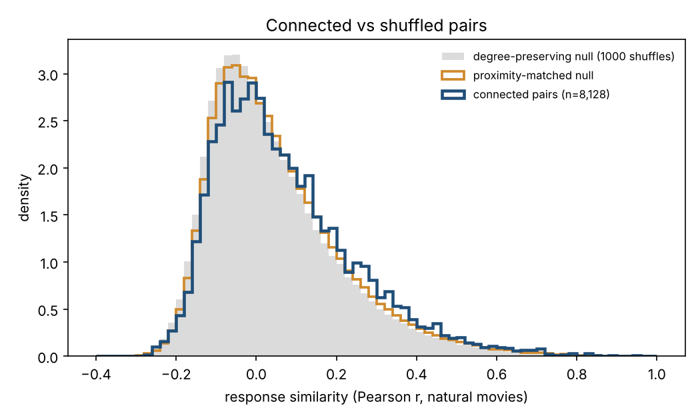
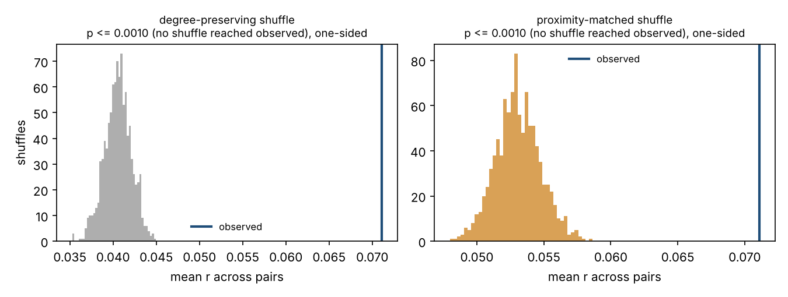
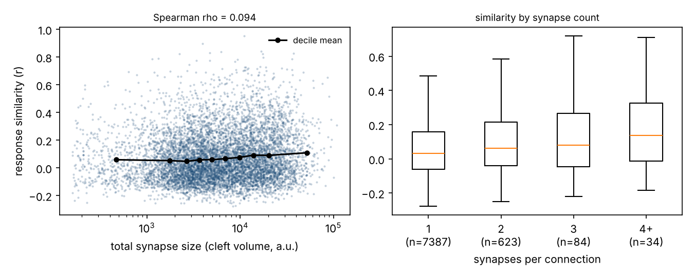
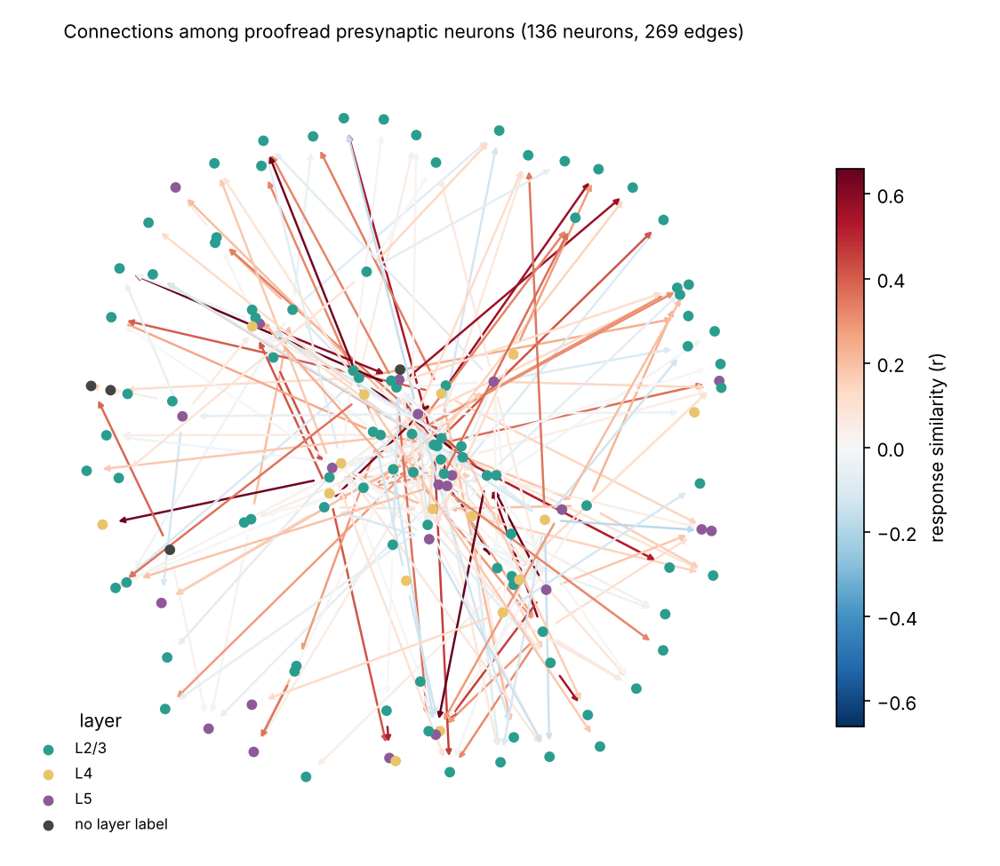

# Do connected neurons respond alike? Structure and function in the MICrONS connectome

**Question.** In mouse visual cortex, do neurons joined by a synapse respond more
similarly to natural movies than neurons that are not connected? And does any
similarity survive once two simpler explanations are ruled out:

1. the **degree structure** of the network (some neurons have many partners and
   happen to be broadly responsive), and
2. **physical proximity** (an axon can only synapse onto dendrites it passes
   near, and nearby neurons may share inputs or receptive fields)?

**Short answer (real MICrONS data).** Yes, but the effect is small. Connected
pairs have a mean response correlation of r = 0.071, against 0.041 for
degree-preserving shuffled networks and 0.053 for proximity-matched shuffles.
None of 1,000 shuffles reached the observed mean under either null
(p ≤ 0.001). About 40% of the raw "connected > shuffled" difference is
explained by proximity alone. See [Results](#results) for numbers and caveats.

---

## Data

All analyses use the public **MICrONS cubic-millimetre (minnie65)** dataset: an
electron-microscopy reconstruction of mouse visual cortex co-registered with
two-photon calcium imaging of the same neurons.

| item | value |
|---|---|
| source tables | `node_data_v1.pkl`, `edge_data_v1.pkl` (functional-connectomics release v1) |
| location | `s3://bossdb-open-data/iarpa_microns/minnie/functional_data/functional_connectomics/node_and_edge_properties/v1/` (public, no credentials) |
| accompanying paper | Ding, Fahey, Papadopoulos et al. (2025), *Functional connectomics reveals general wiring rule in mouse visual cortex*, Nature. [doi:10.1038/s41586-025-08840-3](https://doi.org/10.1038/s41586-025-08840-3) |
| dataset paper | MICrONS Consortium (2025), Nature. [doi:10.1038/s41586-025-08790-w](https://doi.org/10.1038/s41586-025-08790-w) |
| neurons with functional responses | 12,894 (layers L2/3, L4, L5; areas V1, RL, AL, LM) |
| proofread presynaptic neurons | 148 |
| connected pairs (≥ 1 synapse) | 8,128, onto 4,811 postsynaptic neurons |
| proximal but unconnected pairs ("ADP") | 287,243 |
| response vector per neuron | `in_vivo_mean_resp`: 120 values, described in the release as the trial-averaged in vivo response to naturalistic movie stimuli |

Only presynaptic neurons whose axons were proofread are included as sources, so
the network is a set of 148 well-traced "hub" neurons and everything they
contact among functionally imaged cells. It is not the full connectome.

The live CAVE API (`caveclient`) was not used; the static release above
contains the same synapse counts already joined to functional units.

**Sanity check.** Pearson r computed here from the response vectors matches the
release's own `in_vivo_sig_corr` column for every connected pair (max absolute
difference 1.9 × 10⁻⁷), so the similarity measure is the same one the original
authors call in vivo signal correlation.

## Methods

1. **Similarity.** For every connected pair (pre → post), Pearson r between the
   two neurons' 120-value response vectors.
2. **Null 1: degree-preserving shuffle (1,000 networks).** The postsynaptic
   column of the edge list is permuted, which keeps every neuron's in-degree and
   out-degree exactly. Self-loops and duplicate edges created by the permutation
   are removed with double-edge swaps, which also keep degrees.
3. **Null 2: proximity-matched shuffle (1,000 networks).** Each presynaptic
   neuron keeps its number of targets, but they are redrawn from all neurons
   whose dendrites co-travel with its axon (connected or not), with probability
   proportional to axon–dendrite co-travel length. This asks: given where the
   axon goes, is the choice of partner still like-to-like?
4. **Tests.**
   - *Permutation test (primary):* one-sided p = P(null mean r ≥ observed mean r).
     With 1,000 shuffles the smallest possible p is 1/1001 ≈ 0.001.
   - *Per-neuron test (cluster-aware):* for each presynaptic neuron, its observed
     mean r minus its expected mean r under the null, then a one-sided Wilcoxon
     signed-rank test across neurons. This respects the fact that pairs sharing
     a presynaptic neuron are not independent.
   - *Effect size:* Cliff's δ (rank-biserial) between observed pairs and the
     pooled shuffled pairs, from a Mann–Whitney U test. The Mann–Whitney p value
     is reported in `results.json` but is inflated by non-independence and should
     not be read as the main inference.
5. **Connection strength.** Spearman correlation between response similarity
   and (a) summed synaptic cleft volume and (b) number of synapses per connection.
6. **Subset.** Everything is repeated for L2/3 → L2/3 connections only.

## Results

All numbers below are from the real MICrONS data (`results/results.json`,
seed 2025, 1,000 shuffles per null).

### All connections (8,128 pairs, 148 presynaptic neurons)

| comparison | observed mean r | null mean r [95% range] | Δ mean r | permutation p | Cliff's δ | per-neuron Wilcoxon p | neurons above null |
|---|---|---|---|---|---|---|---|
| degree-preserving null | 0.071 | 0.041 [0.037, 0.043] | +0.031 | ≤ 0.001 | 0.10 | 1.2 × 10⁻⁷ | 72% |
| proximity-matched null | 0.071 | 0.053 [0.050, 0.057] | +0.018 | ≤ 0.001 | 0.06 | 8.4 × 10⁻⁵ | 64% |

### L2/3 → L2/3 only (2,621 pairs, 81 presynaptic neurons)

| comparison | observed mean r | null mean r [95% range] | Δ mean r | permutation p | Cliff's δ | per-neuron Wilcoxon p | neurons above null |
|---|---|---|---|---|---|---|---|
| degree-preserving null | 0.078 | 0.047 [0.042, 0.052] | +0.031 | ≤ 0.001 | 0.11 | 7.6 × 10⁻⁶ | 72% |
| proximity-matched null | 0.078 | 0.069 [0.063, 0.074] | +0.010 | ≤ 0.001 | 0.03 | 0.034 | 58% |

### Connection strength

| subset | synapse size vs r (Spearman ρ) | synapse count vs r (Spearman ρ) | mean r, multi-synapse vs single |
|---|---|---|---|
| all | 0.094 (p = 1.8 × 10⁻¹⁷) | 0.055 (p = 6.4 × 10⁻⁷) | 0.106 (n = 741) vs 0.068 (n = 7,387) |
| L2/3 → L2/3 | 0.077 (p = 8.6 × 10⁻⁵) | 0.030 (p = 0.12) | 0.102 (n = 178) vs 0.076 (n = 2,443) |

### Figures

| | |
|---|---|
|  |  |
|  |  |

Matching `_L23_to_L23` figures are in `results/`. The graph shows the 269
connections among the proofread presynaptic neurons themselves (spring layout,
edges coloured by response similarity, nodes by layer).

### Interpretation

- **There is a like-to-like signal, and it is not just network degree.** Against
  the degree-preserving null the observed mean sits about 20 null standard
  deviations above the shuffled mean, and 72% of presynaptic neurons are more
  similar to their real partners than to shuffled ones.
- **Proximity explains a good part of it.** Restricting shuffles to partners the
  axon actually passes cuts the excess similarity from +0.031 to +0.018 (all
  connections) and from +0.031 to +0.010 (L2/3 → L2/3). For L2/3 → L2/3 the
  per-neuron test is only marginal (p = 0.034) once proximity is controlled.
- **The effect is small at the level of single pairs.** Cliff's δ of 0.03–0.10
  means the connected and shuffled distributions overlap heavily: a single
  connection says little about two neurons' tuning. The signal is in the
  population average.
- **Stronger connections are slightly more similar.** Both cleft volume and
  synapse count correlate positively with response similarity, though weakly
  (ρ < 0.1).
- These findings are consistent with the like-to-like wiring reported by the
  source paper, which analysed the same tables with different statistics
  (mixed-effects models and digital-twin-derived tuning). This repository is an
  independent and simpler re-analysis, not a new discovery.

### Limitations

- Presynaptic neurons are a hand-proofread subset of 148 cells, chosen by the
  original team, not a random sample.
- The proximity null uses co-travel length as given in the release; it does not
  control for receptive-field overlap or cortical depth beyond what proximity
  captures.
- Signal correlation over 120 trial-averaged values is a coarse summary of tuning.
  Other similarity measures (orientation preference, digital-twin readout
  similarity, also present in the release) could give different effect sizes.
- With 1,000 shuffles, permutation p values cannot go below ≈ 0.001.

## Reproduce

```bash
pip install -r requirements.txt
python download_microns.py --dest data          # ~500 MB from BossDB
python microns_connectivity.py --data-dir data --out results --n-shuffles 1000
```

The full run takes a few minutes on one CPU core and writes `results/results.json`
plus the figures.

**Smoke test (synthetic data).** `python microns_connectivity.py --synthetic`
builds a 500-neuron synthetic network with a planted effect so the pipeline can
run without the download. Its output is labelled `SYNTHETIC` in the JSON and on
every figure and is not a result. CI runs this plus the unit tests
(`pytest`), which check that the shuffles preserve degrees, never create
self-loops or duplicate edges, and that the similarity measure equals
`numpy.corrcoef`.

## Repository layout

```
microns_connectivity.py   analysis: similarity, null models, statistics, figures
download_microns.py       fetches the public release tables
tests/                    pytest unit tests and a synthetic end-to-end test
results/                  figures and results.json from the real-data run
.github/workflows/        CI smoke test
```

## Citation

If you use these data, cite the MICrONS Consortium (2025) and Ding et al. (2025)
papers listed above.

## License

Code: MIT (see `LICENSE`). Data are distributed by the MICrONS project under their own terms.
